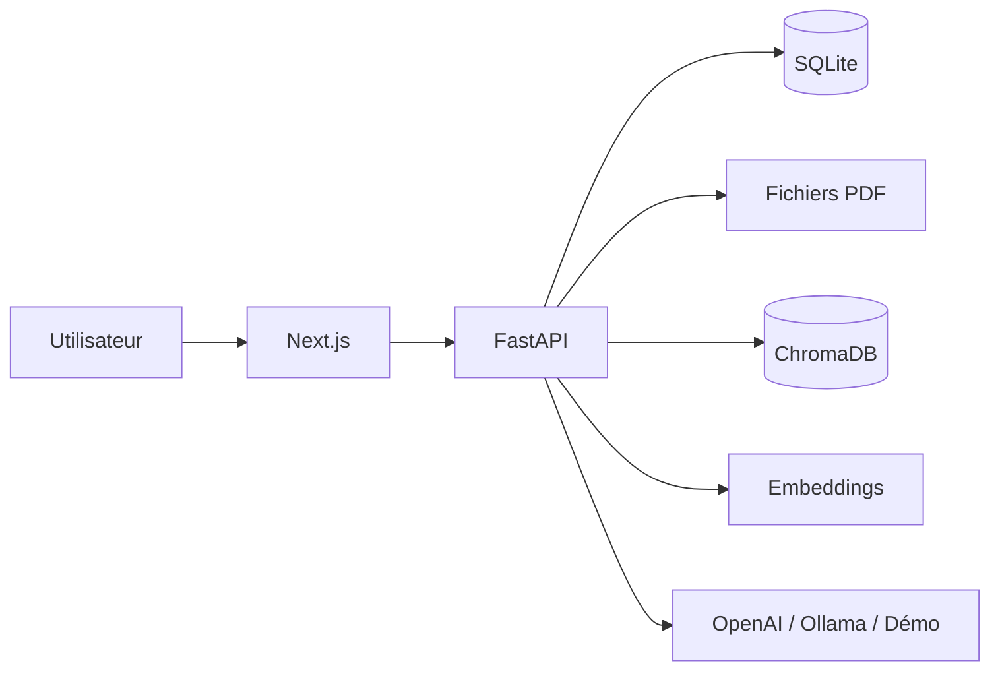

# Architecture — DocuMind AI

## Vue d’ensemble

DocuMind AI sépare clairement le **frontend** (Next.js, App Router) et le **backend** (FastAPI). L’utilisateur interagit avec l’interface ; le backend orchestre l’ingestion PDF, l’indexation vectorielle, la recherche sémantique et la génération.

## Frontend

- Pages : tableau de bord, documents, visualiseur, chat, résumés, QCM, comparaison, paramètres.
- Le client HTTP (`lib/api.ts`) appelle uniquement l’API REST.
- Le thème clair/sombre est local au navigateur.
- Aucun secret n’est stocké dans le frontend.

## Backend

- `app/api` : routes REST validées par Pydantic.
- `app/services` : règles métier (documents, chat, résumés, QCM, comparaison).
- `app/document_processing` : extraction PyMuPDF, nettoyage, chunking.
- `app/embeddings` : Sentence Transformers ou vecteurs factices de test.
- `app/vector_store` : persistance ChromaDB.
- `app/rag` : retriever + prompt + génération.
- `app/llm` : abstraction des fournisseurs.

## Stockage

| Donnée | Emplacement |
| --- | --- |
| Métadonnées, conversations | `data/app.db` (SQLite) |
| Fichiers PDF | `data/uploads/{document_id}.pdf` |
| Vecteurs | `data/chroma` |

Les identifiants UUID relient documents, chunks (`{document_id}:{index}`), conversations et messages. Une migration future vers PostgreSQL et un stockage objet peut remplacer SQLite et le disque local sans changer les contrats d’API.

## CORS

En développement : `http://localhost:3000` et `http://127.0.0.1:3000`. En production, restreindre `CORS_ORIGINS` au domaine réel et ajouter HTTPS, authentification et contrôle d’accès.

## Sécurité (périmètre local)

Application **mono-utilisateur locale**, sans authentification. Avant une exposition publique : comptes, CSRF, rate limiting réseau, isolation multi-tenant, antivirus sur les uploads, sauvegardes et secrets managés.
