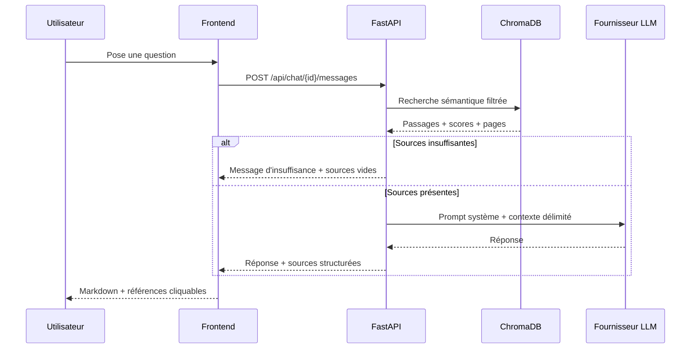

# Pipeline RAG

## Ingestion

1. Upload PDF, contrôle du type, de l’en-tête `%PDF`, de la taille et du nom.
2. Empreinte SHA-256 : un doublon est refusé.
3. Extraction de texte par page avec PyMuPDF. Le numéro de page est conservé.
4. Si le fichier est vide de texte, statut `empty`.
5. S’il ressemble à un scan (pages sans texte extractible), statut `scanned`. **Aucun OCR n’est exécuté** dans cette version ; Tesseract pourra être branché plus tard.

## Nettoyage et chunking

Le texte est normalisé (espaces, retours ligne). Les phrases sont regroupées jusqu’à `CHUNK_SIZE` caractères, avec `CHUNK_OVERLAP`. Chaque passage contient `document_id`, `document_name`, `page_number`, `chunk_id` et le texte.

## Embeddings et index

Le modèle par défaut `paraphrase-multilingual-MiniLM-L12-v2` convient au français (et pourra servir à l’anglais/arabe). Les vecteurs sont stockés dans ChromaDB. Réindexer un document remplace ses vecteurs. Le supprimer les enlève aussi.

## Question-réponse

Le prompt système impose de ne pas inventer, de signaler le manque d’information, de citer les pages réellement récupérées et d’ignorer les instructions éventuellement présentes dans les PDF.

Le **score** Chroma (1 − distance cosinus) n’est pas une probabilité calibrée. Un seuil `RAG_SCORE_THRESHOLD` filtre les passages trop faibles.

## Mode démonstration

Si `LLM_PROVIDER=demo`, la recherche a lieu mais **aucune génération IA réelle** n’est effectuée. L’interface l’indique clairement.
